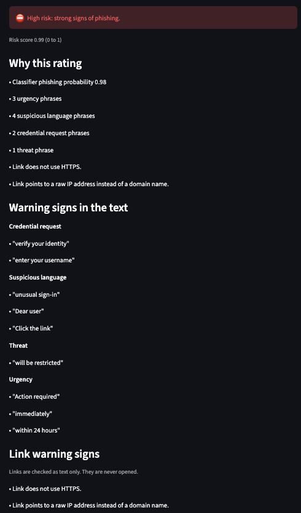
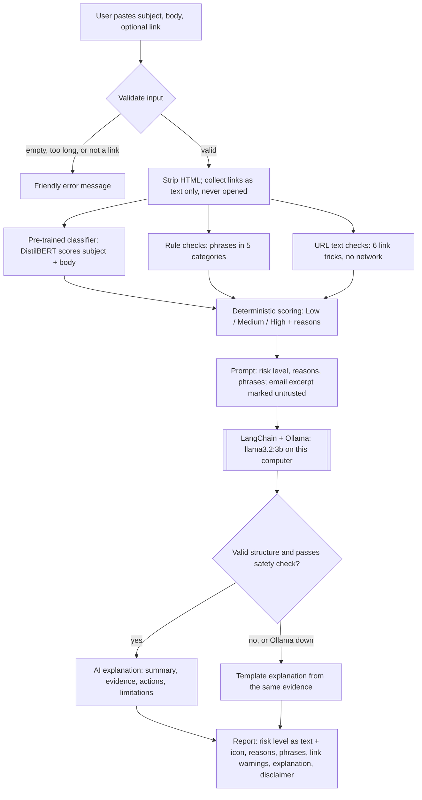
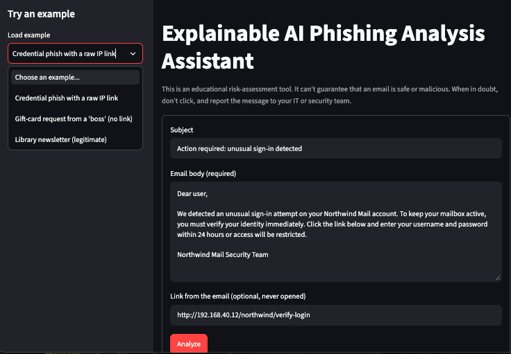
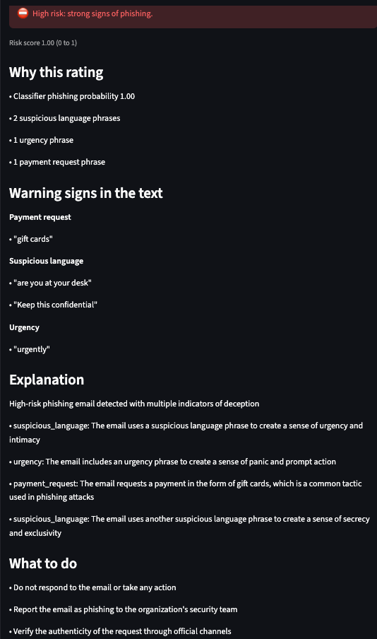
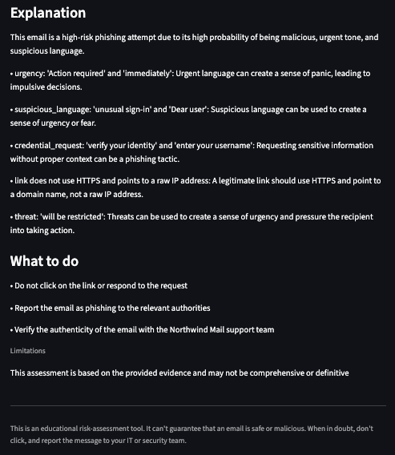

# Explainable AI Phishing Analysis Assistant

A local Streamlit app that rates how likely an email is to be phishing and explains **why**, in plain language, using a pre-trained classifier, transparent rule checks, and a local open-source LLM. No email content leaves your computer.



> **Disclaimer.** This is an educational risk-assessment tool for CAP 942. It can't guarantee that an email is safe or malicious, and it doesn't replace your email security tools, IT, or security team. When in doubt, don't click, and report the message.

## Features

- **Paste and analyze:** subject, body, and an optional link, or load one of 3 example emails from the sidebar.
- **Three analysis layers:**
  - a pre-trained Hugging Face classifier scores the subject and body;
  - rule checks find social-engineering phrases in 5 categories: urgency, threat, credential request, payment request, suspicious language;
  - URL text checks flag 6 link tricks (no HTTPS, raw IP address, punycode, `@` trick, URL shorteners, too many subdomains) **without ever opening the link**.
- **Deterministic risk level:** Low / Medium / High from a fixed formula, with every reason listed. The LLM never sets the risk level.
- **AI explanation:** `llama3.2:3b` running locally in Ollama explains the evidence and suggests safe next steps, through a LangChain chain with structured output.
- **Safety checks on the AI's answer:** if the explanation calls an email safe or legitimate, makes a guaranteed claim, or cites evidence that wasn't found, a plain template explanation is shown instead. The same happens if Ollama isn't running.
- **Built for untrusted input:** HTML is stripped on input, all email and AI text is displayed as plain text, links are never clickable, and the app only accepts connections from your own computer.

## How it works



1. **Validate:** reject empty or oversized input and non-link "links"; strip HTML.
2. **Analyze:** the classifier, rule checks, and URL checks run on the cleaned text.
3. **Score:** `score = 0.6 × classifier probability + 0.4 × min(1, indicator points / 5)`; Low < 0.35 ≤ Medium < 0.65 ≤ High. A credential request plus any link warning is always at least Medium.
4. **Explain:** the LLM gets the risk level and evidence, with the email excerpt fenced off as untrusted data, and returns a structured explanation that's checked before display.

## Tech stack and models

| Part | Choice | License |
|---|---|---|
| Phishing classifier | [`cybersectony/phishing-email-detection-distilbert_v2.4.1`](https://huggingface.co/cybersectony/phishing-email-detection-distilbert_v2.4.1) (DistilBERT, pre-trained; no training or fine-tuning here) | Apache-2.0 |
| Generative LLM | [`llama3.2:3b`](https://ollama.com/library/llama3.2) via [Ollama](https://ollama.com) | Llama 3.2 Community License |
| LLM chain | [LangChain](https://python.langchain.com) (`langchain-core`, `langchain-ollama`): prompt template → `ChatOllama` → Pydantic structured output | MIT |
| Classifier runtime | Hugging Face `transformers` + PyTorch (CPU) | Apache-2.0 / BSD |
| UI | [Streamlit](https://streamlit.io) | Apache-2.0 |
| Rules and URL checks | Python standard library (`re`, `urllib.parse`, `ipaddress`, `html.parser`) | PSF |
| Project and dependencies | [uv](https://docs.astral.sh/uv/) with a committed `uv.lock`; `pytest` and `ruff` for testing and linting | — |

**No database.** The app has no retrieval or memory feature, and it deliberately stores nothing, so none is needed.

## Requirements

- macOS (developed and tested on an Intel Mac with 16 GB of RAM). Linux and Windows should work but are untested.
- Python 3.12 (uv installs it automatically).
- The [Ollama](https://ollama.com) app.
- About 4 GB of free disk space: about 2 GB for `llama3.2:3b`, about 0.3 GB for the classifier, and the Python packages.
- An internet connection for setup only.

## Setup

1. **Install uv** (in Terminal), then close and reopen Terminal:
   ```bash
   curl -LsSf https://astral.sh/uv/install.sh | sh
   ```
2. **Install Ollama:** download the macOS app from [ollama.com](https://ollama.com), open it (a llama icon appears in the menu bar), then download the model:
   ```bash
   ollama pull llama3.2:3b
   ```
3. **Get the code and install dependencies:**
   ```bash
   git clone https://github.com/kitsi/Kit_Sidhu_CapstoneAI.git
   cd Kit_Sidhu_CapstoneAI
   uv sync
   ```
4. **Download the classifier once** (about 0.3 GB, cached for later runs):
   ```bash
   uv run python scripts/download_models.py
   ```
5. **Optional: check the environment.** This prints Python, PyTorch, and Transformers versions and whether Ollama has the model:
   ```bash
   uv run python scripts/check_env.py
   ```

## Run

With the Ollama app open:

```bash
uv run streamlit run app.py
```

Then open the **Local URL** it prints (usually http://localhost:8501). Stop it with `Ctrl+C`.

- The first analysis loads the classifier (a few seconds). The AI explanation takes about 15–55 seconds on a laptop CPU, and a spinner shows while it works.
- To run fully offline after setup, start it with `HF_HUB_OFFLINE=1 uv run streamlit run app.py`. Otherwise `transformers` checks Hugging Face for model updates at startup; it sends only the public model name, never email content.
- `.streamlit/config.toml` keeps the app private: it listens on your computer only, sends no usage statistics, and never shows error details in the browser.

## Tests and evaluation

```bash
uv run pytest                          # 121 tests; the LLM is replaced by a fake, so Ollama isn't needed
uv run python eval/run_eval.py         # risk level vs expected label for the 10 sample emails
```

## Example inputs and outputs

All examples are synthetic emails from [`eval/eval_set.jsonl`](eval/eval_set.jsonl) and can be loaded from the app's sidebar.

| Input | Result |
|---|---|
| **Credential phish:** "unusual sign-in detected … verify your identity immediately … enter your username and password within 24 hours", link `http://192.168.40.12/…` | ⛔ **High** (0.99): urgency, threat, credential-request, and suspicious-language phrases; link uses no HTTPS and a raw IP address |
| **Gift-card scam (no link):** "are you at your desk? … buy five $200 Apple gift cards … Keep this confidential" | ⛔ **High** (1.00): payment request, urgency, suspicious language, caught without any link |
| **Library newsletter (legitimate)** | ℹ️ **Low** (0.00): no social-engineering phrases found |

| Input form | Report | AI explanation |
|---|---|---|
|  |  |  |

The screenshots show the app before the final prompt change; current explanation wording differs slightly (see [evaluation results](docs/evaluation_results.md)).

## Evaluation results

Full details: [`docs/evaluation_results.md`](docs/evaluation_results.md).

- **Detection: 8/10 correct.** All 5 phishing samples are rated High (no false negatives). 3 of 5 legitimate samples are Low; a requested password reset and an order confirmation are rated Medium because the classifier alone flagged them (no rule phrases fired). Thresholds were deliberately not tuned to those 2 samples.
- **AI explanations:** scored 0–2 on faithful, clear, actionable, and safe. A prompt change raised phishing explanations from 5.5 to 7.0 out of 8. On harmless emails the small model tends to invent evidence or vouch for the sender, so the safety check shows the template explanation instead.

The sample set is small and the rule patterns were written from the same phishing samples, so these numbers are a sanity check, not a real-world accuracy figure.

## Limitations and responsible use

- English only; no analysis of headers, senders, or attachments.
- The classifier reads only the first 512 tokens of long emails (the report says so when this happens).
- Legitimate account emails (password resets, order confirmations) can be rated Medium: they use the same vocabulary phishing imitates.
- Rule checks can be evaded by rewording; the URL checks can flag legitimate two-part country domains such as `mail.example.co.uk`.
- The 3B LLM is slow on CPU and often can't explain harmless emails well; the template explanation covers those cases.
- **Never treat "Low" as "safe."** Use the evidence to decide, verify requests through a channel you already know, and report suspicious messages.
- Only paste emails you're allowed to share. Nothing is stored or logged, but the email is visible on your screen.

## Roadmap

- **SHAP explanations** showing which words pushed the classifier's score up or down.
- **Email header analysis:** From vs Reply-To mismatches and SPF/DKIM/DMARC results.
- In-text highlighting of matched phrases (cut for time; phrases are listed by category).
- A larger, independently written evaluation set.

## Project structure

```
app.py                      Streamlit UI (calls pipeline.analyze only)
src/phish_assistant/        validation, classifier, rules, url_checks, scoring,
                            prompts, explainer, pipeline, models, config
tests/                      pytest suite (no network, LLM replaced by a fake)
eval/                       sample emails and evaluation script
scripts/                    environment check, model download, classifier exploration
docs/                       proposal, research notes, data sources, workflow diagram,
                            final documentation, evaluation results, build notes
```

## Acknowledgments

- Built for **CAP 942 – Capstone Project: AI Application Development** by Kit Sidhu.
- **AI assistance:** developed with [Claude Code](https://claude.com/claude-code) (Anthropic) in VS Code. Claude Code wrote most of the code and drafts of the documentation under my direction; I made the design decisions (label mapping, weights, thresholds, what to cut), reviewed every change, and tested the app. Commits it helped write carry a `Co-Authored-By: Claude` line.
- Classifier by [cybersectony](https://huggingface.co/cybersectony) on Hugging Face; Llama 3.2 by Meta; Ollama, LangChain, Hugging Face Transformers, and Streamlit by their respective maintainers.
