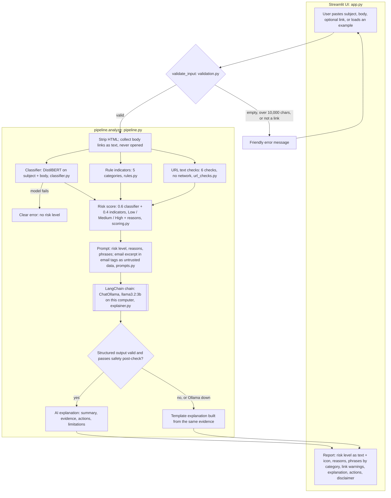

# Technical Workflow Diagram

The diagram follows the real code: each box names the module that does the work. `pipeline.py` runs the steps in order and returns one report to `app.py`.

TODO (Kit): export the diagram below at [mermaid.live](https://mermaid.live) (paste the code, then Actions → PNG) and save it as `docs/workflow_diagram.png`. GitHub also renders the Mermaid code below directly.

## What happens at each step

| Step | Module | Notes |
|---|---|---|
| Input | `app.py` | Streamlit form; a sidebar loads 3 example emails. All email and AI text is displayed with `st.text` (no HTML or Markdown). |
| Validate | `validation.py` | Rejects bad input with a user-readable message; strips HTML; extracts links as text. |
| Classify | `classifier.py` | Pre-trained model loaded once; phishing probability = `LABEL_1` score; flags input over 512 tokens. If it fails, the run stops with a clear message. |
| Rules | `rules.py` | Case-insensitive patterns with word boundaries; returns category, phrase, and position. |
| URL checks | `url_checks.py` | `urlsplit` only: no HTTPS, raw IP, punycode, `@` trick, shorteners, more than 1 subdomain. |
| Score | `scoring.py` | Pure function; the only place a risk level is created. Credential request + any link warning ⇒ at least Medium. |
| Prompt | `prompts.py` | System rules + evidence; email excerpt (max 1,500 characters) fenced in `<email>` tags. |
| Explain | `explainer.py` | `ChatPromptTemplate` → `ChatOllama` → Pydantic structured output → safety post-check; any failure → template fallback. Never raises. |
| Display | `app.py` | Shows `report.assessment.level` from scoring, never anything the LLM wrote about the level. |

**Data storage:** none. There's no database or vector store; the email exists only in memory for the current browser session, and logs contain only stage timings and error types.
